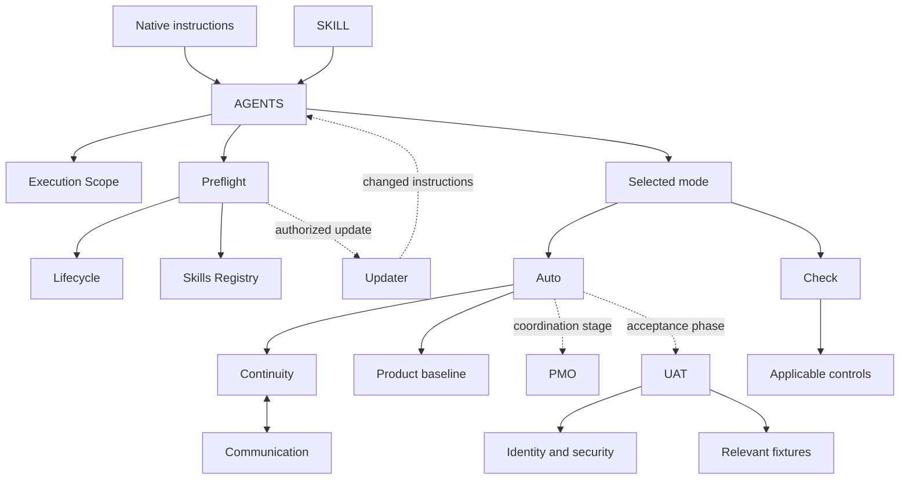

# PHDK intelligent development architecture audit

Audit date: 2026-10-18. Publication date: 2026-10-21. Publication version: v2.60.1.

Audited baseline: **v2.56.0**, commit [`12bfc70134fca8b5350fde84c01e3110f6d54544`](https://github.com/tuyoisaza/PHDK/tree/12bfc70134fca8b5350fde84c01e3110f6d54544).

This is the durable publication of the architectural audit previously delivered in conversation. It is a historical assessment and proposal, not an operating instruction or a re-audit of v2.60.0. The initial audit was read-only; the owner subsequently authorized versioned publication to main. No architectural recommendation is implemented by this publication.

## Publication addendum

Fresh main before publication was v2.60.0, commit `73c81341d280262343e253687da3b6127d472fbf`. Inspection of current source and the archived release history confirms that v2.57.0 introduced `PHDK_INTELLIGENT_EXECUTION.md`, general bounded in-session delegation, L0-L4 context routing and compact recovery guidance; v2.57.1 corrected its coherence guard. Thus the baseline finding about delegation exclusivity is historical and must not be presented as current policy. Actual downstream adoption, worker utilization and performance improvements remain unverified.

Versions v2.58.0-v2.60.0 also changed verification, tenant-risk and Design policy. Those later policies govern current work; the proposals below preserve the audited baseline rather than overriding current rules. This report is intentionally absent from the vendoring manifest and is not mandatory agent context.

## Executive verdict

PHDK provides useful security, continuity, integration and delivery controls, but distributes them through large entrypoints and many overlapping instructions. The recommended baseline intervention was a **moderate modular refactor**: a small kernel, progressive context loading and bounded delegation available across modes, while PMO retains portfolio governance and the primary agent owns integration.

| Dimension | Baseline assessment | Qualification |
|---|---|---|
| Context overload | HIGH | Document sizes and broad reading routes verified; actual runtime consumption unknown |
| Documentation duplication | HIGH semantic; low literal | Similar obligations recur with different wording |
| Progressive loading maturity | 2/5 | Routing and applicability exist, but universal surfaces remain large |
| Subagent restrictions | HIGH | Baseline explicitly limits task delegation to PMO |
| Actual subagent utilization | UNKNOWN | Policy and available tools do not prove historical execution |
| Intelligent execution maturity | 2/5 | Ownership/dependencies and continuity advisor exist; strategy optimization is incomplete |
| Avoidable execution overhead | HIGH, inferred | No measured latency or cost reduction is claimed |

Scale: 0 absent, 1 intention, 2 partial mechanism, 3 verifiable routing, 4 measured, 5 validated adaptation.

Evidence classes: VERIFIED means inspected source or measured data; INFERRED means a reasoned consequence; HYPOTHETICAL means proposed architecture/budget; UNKNOWN means unavailable evidence. No other agents' audit reports were consulted.

## Inventory and measurement method

The baseline archive was retrieved at the pinned SHA and analyzed in memory, without changing repository files. The inventory covered all 93 files: 65 root Markdown files, 7 ORIGINALS files, 9 scripts, 7 tests, 2 hooks and 3 other root files. Total file bytes: **1,415,337**. The manifest had **69 mappings**, all with existing source files.

For active-document analysis, exclude both changelogs and the coherence report: 62 Markdown documents, **1,111,542 bytes**, **1,109,336 characters**, approximately **277,355 tokens**. Token estimates use ceil(characters/4) per document, not an actual model tokenizer. Assuming 3-5 characters/token changes estimates by approximately -20% to +33%. File bytes and character counts are measurements; token counts are estimates.

| File | Bytes | Estimated tokens |
|---|---:|---:|
| AGENTS.md | 35,764 | 8,930 |
| SKILL.md | 26,645 | 6,658 |
| PHDK_NATIVE_RULES.md | 22,203 | 5,546 |
| EXECUTION_SCOPE.md | 27,934 | 6,983 |
| PHDK_PREFLIGHT.md | 15,210 | 3,794 |
| PHDK_LIFECYCLE.md | 27,058 | 6,752 |
| PHDK_AUTO.md | 49,345 | 12,313 |
| PHDK_AUTO_CONTINUITY.md | 17,003 | 4,249 |
| PHDK_PMO.md | 20,249 | 5,048 |
| PHDK_PLAN.md | 17,240 | 4,282 |
| INANUTSHELL.md | 17,593 | 4,391 |
| USE_COMPANY_CO_INFO_FOR_DEMOS.md | 37,798 | 9,375 |

AGENTS, SKILL and native rules together estimate 21,134 tokens **if all three are loaded**. Repository presence does not establish automatic injection. Host injection, prompt caching, historical rereads, actual tokenization and billing are UNKNOWN. This session's user-supplied instructions were present; that does not establish another runtime's behavior.

Exact paragraph duplication was measured by splitting on blank lines, normalizing whitespace and matching blocks of at least 160 characters across files: 7 repeated groups and 3,161 excess characters, approximately 0.3% of analyzed text. This deliberately strict measure does not quantify semantic repetition. References to Preflight occurred in 17 documents; Force human-review policy occurred in 21. These are dispersion indicators, not duplicated-word percentages.

## Evidence matrix

All references in this matrix refer to the **audited v2.56.0 SHA**, not current main. To inspect a location use `https://github.com/tuyoisaza/PHDK/blob/12bfc70134fca8b5350fde84c01e3110f6d54544/<path>#L<line>`.

| Finding | Exact baseline source | Class | Consequence and correction | Priority |
|---|---|---|---|---|
| Large universal entrypoint | AGENTS.md:1-139 | VERIFIED | Specialized admin/auth/UAT/design instructions precede routing; extract kernel and mode/domain contracts | P1 |
| Task delegation tied to portfolio mode | EXECUTION_SCOPE.md:5-35; PHDK_PMO.md:179-195 | VERIFIED | Prevents useful bounded work outside that mode; generalize the task contract, preserve portfolio governance | P1 |
| Auto/internal-PMO activation ambiguity | PHDK_AUTO.md:219-233,311-332 | VERIFIED; effect INFERRED | Separate mode, execution strategy and authority | P1 |
| Repeated versus once-only Preflight wording | AGENTS.md:117; PHDK_PREFLIGHT.md:23,298-304 | VERIFIED | Reconciliation or repeated checks; use one canonical invalidation rule | P1 |
| Updater versus read-only audit | PHDK_PREFLIGHT.md:3-5; PHDK_CHECK.md:58; scripts/phdk_update.py:12-50 | VERIFIED | Updater clones and may copy files; separate read-only check from authorized application | P1 |
| Full baseline reread at every Auto invocation | PHDK_AUTO.md:188-201 | VERIFIED | Reconcile every requirement ID, but reload detailed content based on changes and risk | P1 |
| Broad Check reading requirement | PHDK_CHECK.md:45-56 | VERIFIED | Inventory all controls, select detailed reading by applicability | P1 |
| Multiple current indexes plus stage copies | PHDK_LIFECYCLE.md:63-127,790-795 | VERIFIED; overhead INFERRED | One operational view and immutable evidence references, with snapshots when necessary | P2 |
| Repeated Force message capsule | PHDK_COMMUNICATION_STANDARD.md:24-36 | VERIFIED | Event-based reporting; retain authority/safety notices where they matter | P2 |
| Useful worker contract lacks performance detail | PHDK_PMO.md:197-257 | VERIFIED | Add minimal-context selection, supported budgets, cancellation and structured result | P1 |
| Continuity advisor is not an execution optimizer | scripts/phdk_auto_gate.py:144-193 | VERIFIED | Preserve dependency/repair advice; add strategy selection separately | P2 |
| Completion checker hardcodes PR route | scripts/phdk_completion_gate.py:50-58 | VERIFIED; false-block potential INFERRED | Model explicitly authorized delivery routes without relaxing remote/check evidence | P2 |

Existing strengths: AGENTS.md:145-170 already recommends minimal loading; JWT_STANDARD.md:24-30 requires the minimum representative fixture subset, not 200 accounts. PHDK_AUTO.md:412-421 already provides milestone publication and final cross-milestone UAT. Preserve these controls.

## Instruction dependency graph

A case-insensitive reference scan resolved existing root Markdown targets. Among the selected active documents it found 600 distinct directed links and one strongly connected component containing 58 documents. These are **reference-graph measurements**, not proof of recursive loading or unconditional mandatory reads. Conditionality and operational meaning require source interpretation.



Representative reciprocal links: AGENTS.md to EXECUTION_SCOPE.md at53, and back at EXECUTION_SCOPE.md:53; PHDK_AUTO_CONTINUITY.md:38,139 to Communication and PHDK_COMMUNICATION_STANDARD.md:26,34 back to Continuity. A loader should memoize document revision/section; a backlink must not trigger an unlimited reload.

## Quantitative context comparison

The following is a **full-document bundle scenario**, not measured model context or billing. The common bundle is AGENTS, Execution Scope, Preflight, Lifecycle, Communication, Commitment and Skills Registry: approximately 34,485 tokens. Add relevant mode/stage documents once each. Product requirements, source, conversation, tools and historical outputs are excluded from both columns.

| Mode/stage | Current bundle estimate | Proposed governance budget, hypothetical |
|---|---:|---:|
| Capture | 44,250 | 3,000-5,000 |
| Plan | 60,806 | 5,000-9,000 |
| Auto entry | 51,047 | 4,000-6,000 |
| Auto Force entry | 51,047 | 4,500-6,500 |
| PMO | 41,770 | 4,000-7,000 |
| Implementation | 71,666 | 3,000-6,000 |
| Authenticated UAT | 62,073 | 6,000-12,000 |
| Designer | 50,262 | 5,000-9,000 |
| Check entry | 43,014 | 6,000-12,000 |

The union of these selected bundles over a full lifecycle estimates 173,064 tokens, not simultaneous context. Reading all 59 nonhistorical manifest Markdown documents estimates 273,442 tokens. An executor may read applicable sections instead. The proposed budgets are design targets that must prove control equivalence, not delivered savings or a latency forecast.

## Target architecture and progressive context

Use a small router and modular references rather than another universally mandatory large standard. The illustrative kernel/router/modes/stages/specialists/workers folder structure is reasonable eventually, but moving files is not itself a performance improvement. Preserve existing paths as wrappers first.

| Layer | Responsibility | Load rule |
|---|---|---|
| L0 Kernel | Current mandate, precedence, security, external boundaries, honesty, stop and integration responsibility | Small permanent surface |
| L1 Mode | Capture, Plan, Auto, Force overlay, PMO, UAT, Designer or Check differences | Active mode only |
| L2 Stage | Present entry/exit gates and evidence requirements | Entry or relevant invalidation |
| L3 Task | Relevant requirements, ADRs, code, diff and acceptance | Task/dependency selection |
| L4 Specialist | Auth, data, AI, security, design, performance and similar domains | Actual applicability/risk |

Stage changes should load only new or invalidated material. Never omit a requirement or safety control merely to meet a token target. Documents already sent to the model cannot be literally unloaded by dropping references. Summaries and retrieval reduce new reading; compaction and genuinely fresh worker contexts depend on the host. Full-history worker forks can multiply context. Separate contexts do not prove filesystem, credential or permission isolation. Prompt-cache savings require real evidence.

## Delegation policy and exact change surface

The proposed baseline policy permits the primary to delegate a bounded part of the current authorized task when the host supports workers and benefit plausibly exceeds setup/integration overhead. It creates no broader scope, access, spending or session duration. Preserve no-recursion by default, stop/cancellation, owned files, central integration and honest evidence. A worker review does not substitute for an actually required human review.

Distinguish portfolio orchestration, bounded in-session delegation, parallel tool calls, independent verification, unattended execution and external execution services. Tool-call parallelism is not itself agent spawning. Background work and external services retain separate controls.

The baseline restriction/reiteration surface covered these 21 files:

- Entry points: AGENTS.md:53,122; SKILL.md:10,34,58,155,167,169,177; PHDK_NATIVE_RULES.md:29,31,51.
- Scope/modes: EXECUTION_SCOPE.md:5,9,31-35,75,112; PHDK_PMO.md:179-218; PHDK_AUTO.md:233,315-332.
- Development: AGILE_SLICE_WORKFLOW.md:11,37,104; AI_DEVELOPER_OPERATING_MODEL.md:7,24,65; DEVELOPMENT_RULES.md:5,17,155; TASK_TRACKING_STANDARD.md:23,127; VERSIONING.md:5,33.
- Routing/distribution: ENFORCEMENT.md:151; INANUTSHELL.md:9,20,113; ONBOARDING_AI_DEVELOPER.md:9,58; PHDK_PREFLIGHT.md:196; SKILLS_REGISTRY.md:7,29,90.
- Compatibility: PHDK_EVOLUTION_STANDARD.md:33; PHDK_UPGRADE.md:16,140; PROJECT_HANDOFF_TO_DEVELOPMENT_KIT_PROMPT.md:318,688; build_app_foundation_prompt.md:61; README.md:354,636.

This list records what needed reconciliation at v2.56.0. Current v2.60.0 already has general delegation policy; do not reapply obsolete restrictions from this historical report.

## Intelligent execution router

Choose direct, sequential, parallel, specialist or PMO execution by: task complexity; dependency graph; actual capabilities; expected context; security/risk; parallelism; coordination overhead; cost/latency; integration and verification needs.

- Small localized work: direct primary execution.
- Strong dependencies or overlapping writes: sequential.
- Independent bounded research: parallel readers where useful.
- Specific expertise or separate technical review: one specialist.
- Stable independent modules: implementation workers.
- Portfolio-level outcomes/hit dependencies: PMO governance using those same capabilities.

Delegate only when expected critical-path, specialization or context benefits exceed startup, duplicated context, coordination and integration costs. Start with disclosed estimates, not invented numerical weights. A deterministic selector and measurement can precede adaptive routing; a new hosted scheduler is unnecessary.

### Worker contract

```yaml
task_id: T-014
objective: concrete outcome
output: patch or structured findings
scope:
  allowed_files: []
  read_only_shared_files: []
  excluded_effects: []
context:
  baseline_sha: observed revision
  requirement_ids: []
  relevant_sections: []
dependencies: []
acceptance_criteria: []
security_constraints: []
resource_owner: primary or assigned owner
budget:
  tokens: advisory unless enforced by host
  time: supported limit or disclosed estimate
  paid_calls: prohibited unless separately authorized
completion_evidence: []
return:
  changed_files: []
  checks: []
  findings: []
  assumptions: []
  blockers: []
```

Research workers need sources and completeness checks; specialist reviewers need bounded questions and evidence; implementers need stable ownership/contracts; test workers need exact permitted environments; broad workstream workers need PMO integration. The primary remains responsible for decomposition, shared-file conflicts, integration, tests, versions, Git delivery and final acceptance. Writing a budget in a prompt is not a technical hard cap.

## Compact operational state and resume packet

Extend AUTO_STATE.json by references rather than adding a competing authorization ledger. Keep objective, mode/stage/milestone, mandate provenance, scope/exclusions, assumptions, source/candidate SHAs, applicable rule IDs/revisions/sections, delivered evidence, pending dependencies, worker ownership/results, blockers and next executable action. A proposed resume view is 1,000-2,000 tokens with details recoverable from authoritative sources.

Recovery reads current instructions plus the packet, verifies changes since checkpoint, reloads invalidated rules, reconciles blockers against actual evidence and executes the next ready action. A compact summary must not erase commitments or act as authorization. Keep full requirements and evidence in their source artifacts.

## Top ten improvements and avoidable overhead

Rank reflects expected value and evidence strength, not measured speed gains.

| Rank | Improvement | Expected value | Complexity | Risk |
|---|---|---|---|---|
| 1 | Small kernel and compact generated entrypoints | High | Medium | Medium: missing safety rule |
| 2 | General bounded delegation using existing PMO contract | High when useful | Medium | Medium: collisions/access |
| 3 | Mode/stage/risk context map | High | Medium | Medium: wrong applicability |
| 4 | Requirement-ID/hash/change-based reconciliation | High for long runs | Medium | Medium: missed invalidation |
| 5 | Dependency/resource-aware strategy router | Potentially high | Medium | Medium: poor estimates |
| 6 | Single operational view plus versioned evidence | Medium/high | Medium | Medium: traceability loss |
| 7 | Nonmutating preflight and pinned run revision | Medium | Low/medium | Low with compatibility |
| 8 | Material-event reporting | Medium | Low | Low |
| 9 | Section-level specialist/fixture retrieval | Medium/high | Medium | Medium: missing controls |
| 10 | Candidate-aware check reuse and typed delivery evidence | Medium/high | Medium | High if reused incorrectly |

Git already deduplicates identical blobs; fewer snapshots do not imply equivalent storage savings. The primary costs can be writing/reading/reconciling state. Reusing validation must consider source, dependencies, configuration and risk; mandatory hooks are preserved.

## Migration roadmap

| Phase | Milestone | Dependency | Acceptance |
|---|---|---|---|
| 0 | Baseline, telemetry and comparable tasks | None | Pinned source; essential controls have stable IDs/evidence |
| 1 | Surgical consistency fixes and check/apply separation | Baseline | Read-only audits never write; recovery avoids repeated interviews/full preflight |
| 2 | Kernel, context map and compatible wrappers | Phase 1 | Control equivalence, old paths, applicability and owner text preserved |
| 3 | General worker contract, ownership and cancellation | Phase 2 | No expanded rights; stop cancels; central integration required |
| 4 | Router in observation mode, then bounded execution and benchmark | Phase 3 | Measured strategies/costs, no quality regression |
| 5 | Gradual vendored-project adoption | Favorable evidence | Safe manifests, cleanup of duplicates and tested version rollback |

Preserve managed markers, owner text outside them and historical evidence. Verify clean/old/partial/locally modified installations. Breaking paths/state schemas require an explicit migration. Safety acceptance covers read-only writes, inherited scope, global files, worker-completion versus integration, stop/cancellation, source/auth/schema/dependency invalidation, unknown/conflicting rules and remote SHA/version/readback. Do not create infrastructure or reactivate old tasks through migration.

## Benchmark proposal

Compare the fixed v2.56.0 baseline with a candidate on identical source snapshots, models, tools, budgets and acceptance criteria. Balance run order; use disposable authorized fixtures, no real data/sends/new paid services. Include small localized fixes, medium independent work, tightly coupled changes, high-risk cases and context-recovery cases. Start with a pilot and choose sample size from observed variability.

| Metric | Definition |
|---|---|
| Time to first useful implementation | First change satisfying a verifiable requirement portion |
| Total completion time | Through required acceptance and integration |
| Token usage | Actual input/output, cache separated when exposed |
| Tool calls | Read/edit/check/delivery counts |
| Documentation read volume | Bytes/sections loaded; same-revision rereads |
| Worker utilization | Workers actually launched, duration, context, useful integrated output |
| Parallel efficiency | Speedup over equivalent sequential work divided by comparable workers |
| Integration failures | Conflicts, discarded work and contract mismatches |
| Quality/test pass rates | Accepted requirements, actual tests and critical defects |
| Cost per completed task | Observed cost per task and per accepted requirement |
| Human intervention | Necessary decisions versus redundant permission questions |

Success means lower time and/or cost per accepted result without additional safety failures, critical defects, missing requirements or integration failures. Report paired differences, medians and variability, not the best run. More workers and fewer documents are not success metrics by themselves. No benchmark or quantitative improvement was executed/claimed by the original audit or this publication.

## Three alternatives

| Alternative | Benefits | Complexity and risk | Maintainability |
|---|---|---|---|
| Minimal surgical optimization | Fix contradictions, reduce reporting, broaden bounded delegation | Low/medium; retains dispersed rules | Limited improvement |
| Moderate modular refactor, recommended | Kernel, progressive routing, reusable workers and compact state | Medium; requires policy-equivalence tests | Good |
| Comprehensive execution architecture | Policy engine, runtime adapters, scheduling decisions, budgets and adaptive telemetry | High; investment not yet justified by measurements | Good only with sustained ownership |

Choose the moderate alternative: it addresses observed causes while reusing existing mechanisms. The comprehensive alternative should follow evidence of residual need, not architectural preference.

## Final recommendation and limits

Load essential rules once; select further context/controls from actual work; allow bounded delegation as an internal strategy; keep PMO for portfolios, milestones and dependencies; retain primary integration and proof of delivery; measure accepted software, time, cost and safety. Preserve real authorization, security/access controls, ownership, mandatory checks and independent remote verification.

The report is historical analysis with a current publication addendum. It does not demonstrate current runtime context, downstream adoption, actual worker execution, deployed behavior or improved throughput. Current operating instructions remain authoritative.
